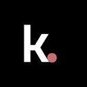
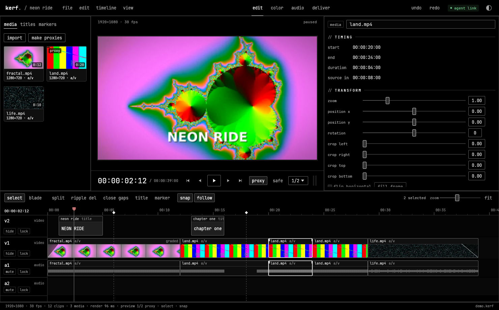
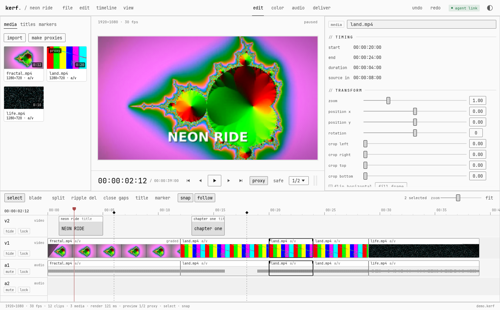
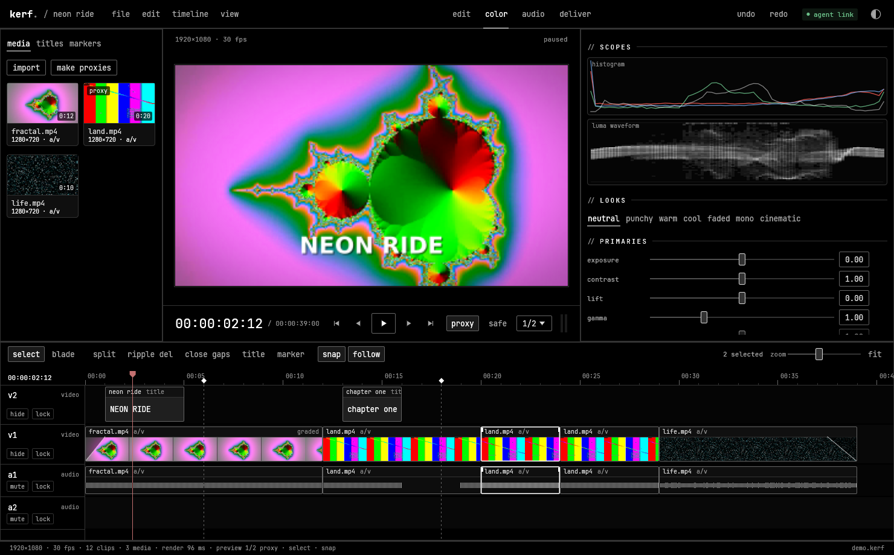

<a id="readme-top"></a>

<div align="center">



<h1>kerf</h1>

<p><b>A fast Rust video editor with a timeline AI agents can cut alongside you.</b><br>Desktop studio, headless CLI and MCP server on one <code>.kerf</code> file, with remote render over SSH.<br><i>kerf</i> (n.): the slit a blade leaves when it cuts.</p>

<p>
  <a href="https://github.com/elyesghazel/kerf/blob/main/LICENSE"></a>
  <a href="https://github.com/elyesghazel/kerf/commits/main"></a>
  
  <br>
  <a href="https://www.rust-lang.org"></a>
  
  
  
  <a href="https://github.com/elyesghazel/kerf/stargazers"></a>
</p>

<p><a href="#features"><b>Features</b></a> · <a href="#quick-start"><b>Quick start</b></a> · <a href="#keys"><b>Keys</b></a> · <a href="#build"><b>Build</b></a> · <a href="AGENTS.md"><b>Agents</b></a> · <a href="ROADMAP.md"><b>Roadmap</b></a></p>

<a href="https://ko-fi.com/elyesghazel"></a>

</div>

---



- **kerf studio** (`kerf-studio`): the desktop editor, styled with the eg. design system (black, JetBrains Mono, hairlines, dark + light). Multi-track timeline,
  colour page with scopes, audio mixer, titles, export. egui + a CPU compositor,
  so it starts instantly and runs on a laptop iGPU.
- **kerf** (`kerf`): the same engine headless. A CLI and an MCP server for agents
  (`kerf mcp`), plus remote rendering on another machine (`kerf export --on pc`).

Both edit the same `.kerf` file. When an agent changes it, the studio picks the
edit up live, and you can undo it with Ctrl+Z.

## Features

**Editing**
- Multi-track video and audio. Linked A/V clips move, trim and split together
  (Alt bypasses the link).
- Select and blade tools, trimming by dragging clip edges, and snapping to clip
  edges, markers and the playhead.
- Ripple delete, cutting out a range across every track, close gaps, and
  keep-only-these-ranges.
- Fades you set by dragging the handles on the clip, markers, and in/out points
  with loop playback.
- Unlimited undo/redo. Dragging a slider counts as one undo step.

**Picture**
- Transform: zoom, position, rotation, crop, flip, and "fill frame" for turning
  landscape footage into vertical.
- Colour: exposure, contrast, lift, gamma, saturation, temperature, tint and
  vignette, plus one-click looks. The histogram and luma waveform scopes update
  live.
- Titles with presets (lower third, caption, reel hook…), and solid mattes.
- Phone footage with rotation metadata is handled. Images work too.

**Speed**
- Media is decoded by the `ffmpeg` binary over pipes instead of linked libav:
  the build doesn't depend on your FFmpeg version, and a decoder crash can't
  take the editor down.
- Proxies: one click makes 540p short-GOP copies for smooth scrubbing of 4K
  HEVC on a weak laptop. Exports always use the originals.
- The preview renders at the size it's shown (1/2 or 1/4 quality to go
  faster). While paused, scrubbing always shows the latest position and never
  queues up.
- Projects are tiny JSON edit lists, saved atomically (written to a temp file,
  then renamed) about 350 ms after each edit. Thumbnails and waveforms are
  cached per file in `~/.cache/kerf`, so reopening a project is instant.

**Delivery**
- Presets: YouTube 1080p, 1080×1920 reel, 4K H.265, fast draft, VA-API GPU
  encode, ProRes.
- **Render on another device:** type an SSH or Tailscale host (`pc`, `vps`) in
  Deliver or pass `--on <host>`. Media is copied over once with rsync and
  cached there, the export runs remotely, and the file comes back.

**Agents**: see [AGENTS.md](AGENTS.md).

## Screenshots

| light | colour page |
| --- | --- |
|  |  |

## Quick start

```sh
kerf new cut.kerf --preset vertical
kerf -p cut.kerf import clip1.mp4 clip2.mp4 --append
kerf -p cut.kerf auto-cut-silence --db -35 --min 0.6
kerf -p cut.kerf text "wait for it" --at 0 --dur 2 --y 0.3 --bold
kerf -p cut.kerf contact -o sheet.png       # agents look at the edit
kerf -p cut.kerf export -o cut.mp4 --on pc  # render on the desktop
claude mcp add kerf -- kerf mcp             # or drive it over MCP
```

## Keys

| Keys | Action |
| --- | --- |
| Space / K / L / J | Play-pause / pause / play / back 2 s |
| ← → (Shift) | Step one frame (one second) |
| ↑ ↓ | Previous / next edit point |
| S or Ctrl+B | Split at the playhead (selected clips, or every track) |
| B / A | Blade / select tool |
| Del / Shift+Del | Delete / ripple delete |
| I / O / Alt+X | Mark in / mark out / clear |
| M / T | Add a marker / add a title |
| N | Toggle snapping |
| + / − / Shift+Z | Zoom in / zoom out / fit |
| Ctrl+wheel | Zoom at the mouse |
| Ctrl+Z / Ctrl+Shift+Z | Undo / redo |
| Ctrl+S / Ctrl+O / Ctrl+I | Save / open / import |
| Ctrl+N | New window (each project gets its own process) |
| Ctrl+E | Deliver |
| F1 | Show all shortcuts |

## Build

Needs Rust and the `ffmpeg`/`ffprobe` binaries at run time; no FFmpeg development
headers are required. The studio also needs ALSA, Wayland and X11 client libs,
which every desktop already has.

```sh
cargo build --release                 # headless: kerf (CLI + MCP)
cargo build --release -p kerf-app     # the studio: kerf-studio
cargo test                            # core, CLI
```

There are headless UI tests that render the real app with software Vulkan and
drive it with pointer events:

```sh
KERF_SHOT_PROJECT=demo.kerf KERF_SHOT_OUT=/tmp cargo test --release -p kerf-app -- --ignored
```

Environment: `KERF_FFMPEG` / `KERF_FFPROBE` (binary paths), `KERF_HWACCEL=none`
(turns off GPU decode), `KERF_FONT` (title font), `KERF_PROJECT` (default
project for the CLI).

## Layout

```
kerf-core    the document model, commands with inverses (undo/redo), and the edit ops
kerf-media   ffmpeg pipes: probing, decoding, thumbnails, waveforms, proxies, detection
kerf-render  the compositor, audio mixer and exporter, shared by the preview and the CLI
kerf-cli     `kerf`: the agent CLI, the MCP server and remote rendering
kerf-app     `kerf-studio`: the egui editor
```

See [ROADMAP.md](ROADMAP.md) for what comes next.

kerf is a side project. For a full Premiere-style editor in Rust, look at
[FilmCraft](https://github.com/storytold/filmcraft).

## Support

If kerf saves you time, you can [buy me a coffee on Ko-fi](https://ko-fi.com/elyesghazel). Bug reports, ideas and
pull requests are just as welcome: [open an issue](https://github.com/elyesghazel/kerf/issues/new).

## Star history

<a href="https://star-history.com/#elyesghazel/kerf&Date">
  <picture>
    <source media="(prefers-color-scheme: dark)" srcset="https://api.star-history.com/svg?repos=elyesghazel/kerf&type=Date&theme=dark">
    
  </picture>
</a>

## License

GPL-3.0-or-later, see [LICENSE](LICENSE).

<div align="right"><a href="#readme-top">back to top ↑</a></div>
